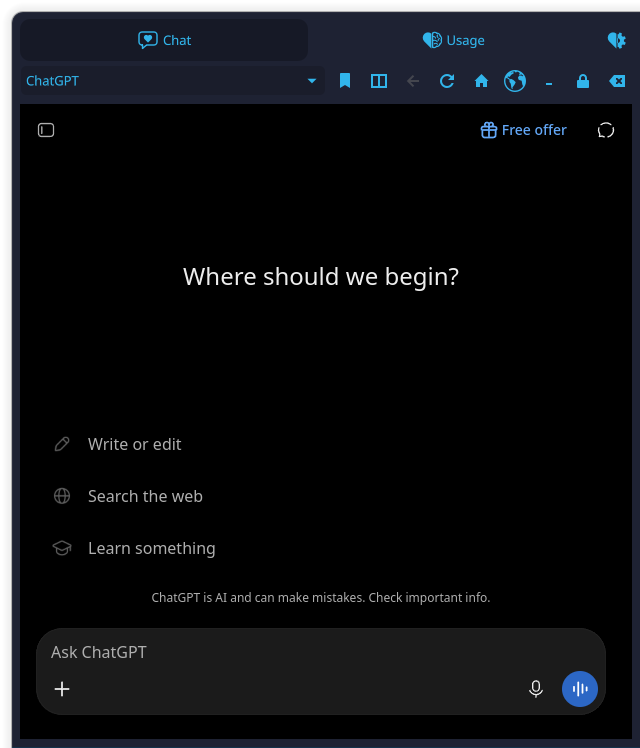
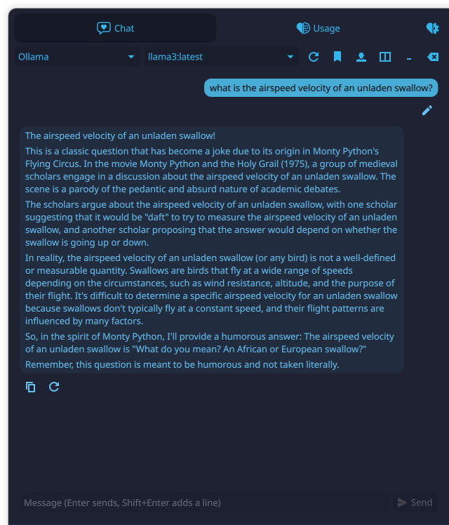
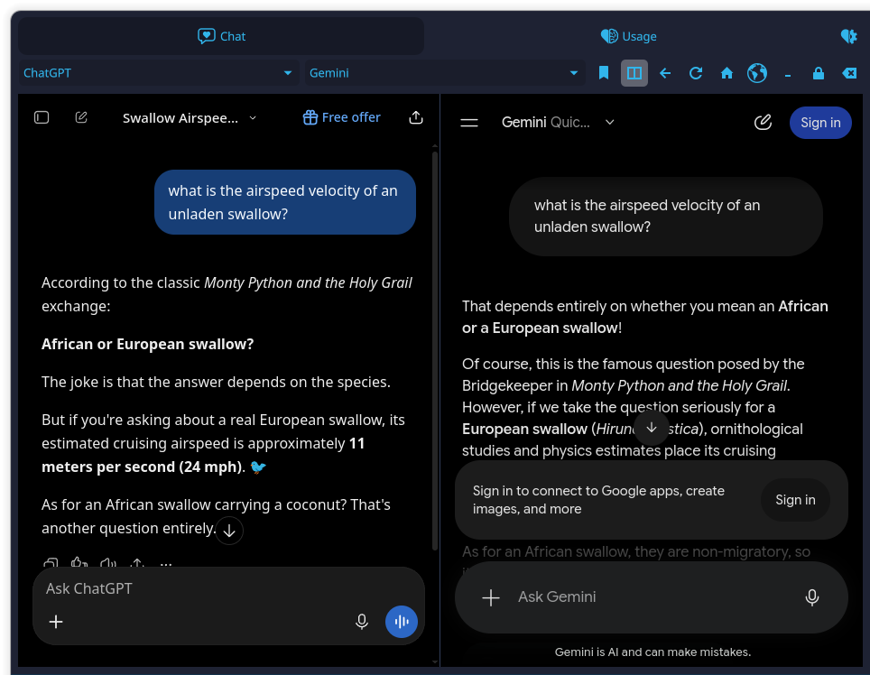
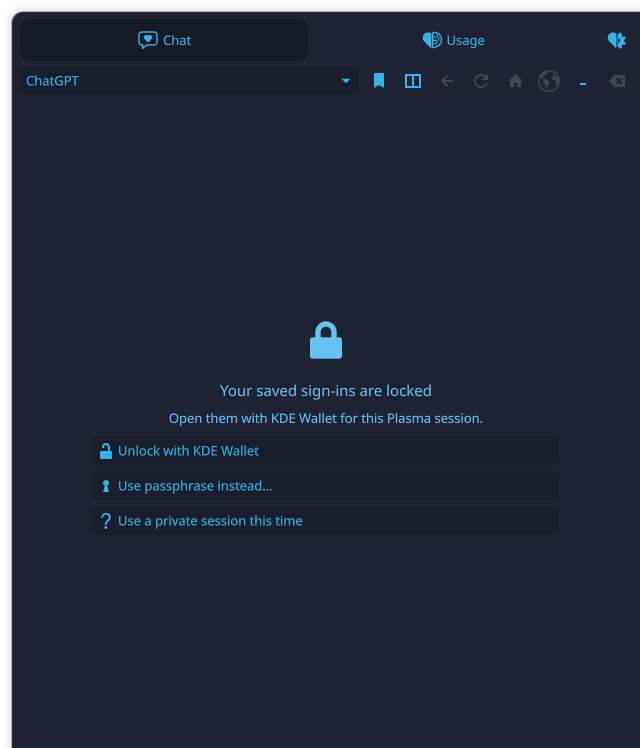
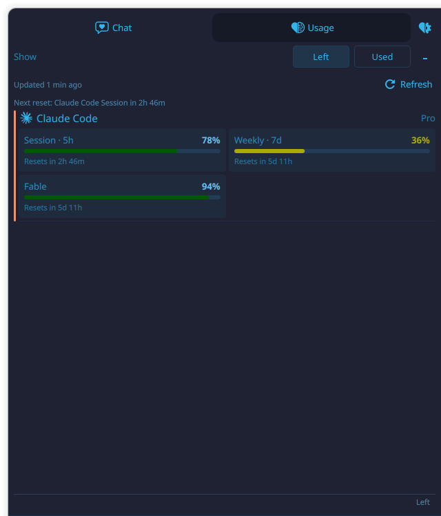
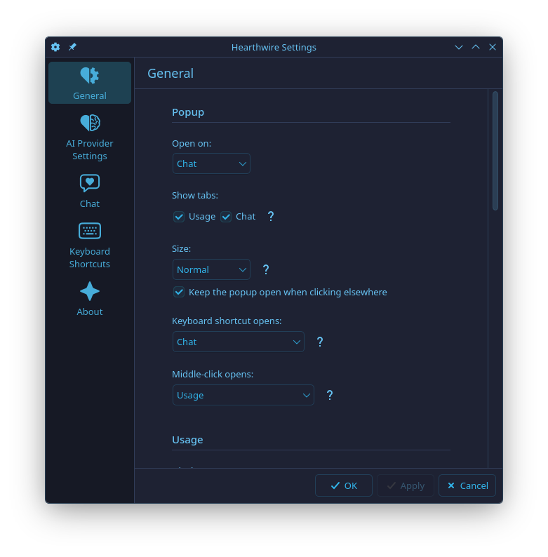
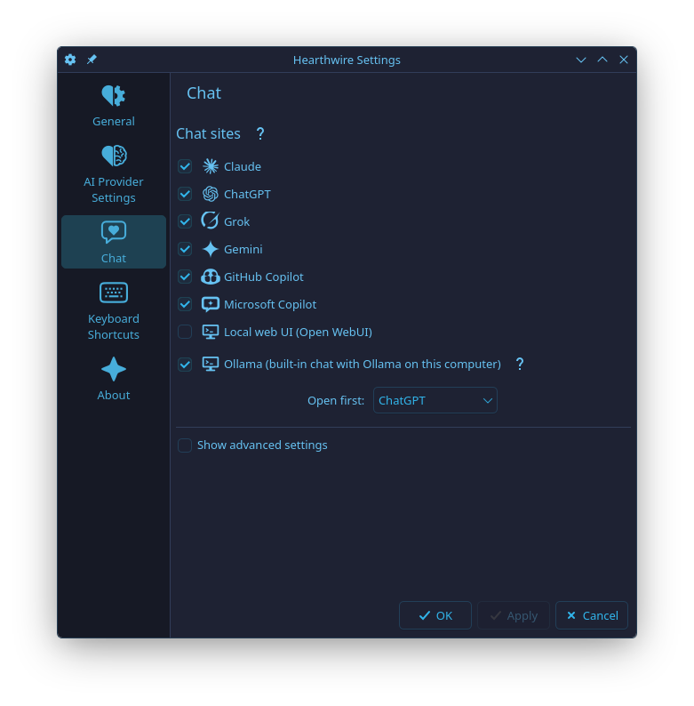
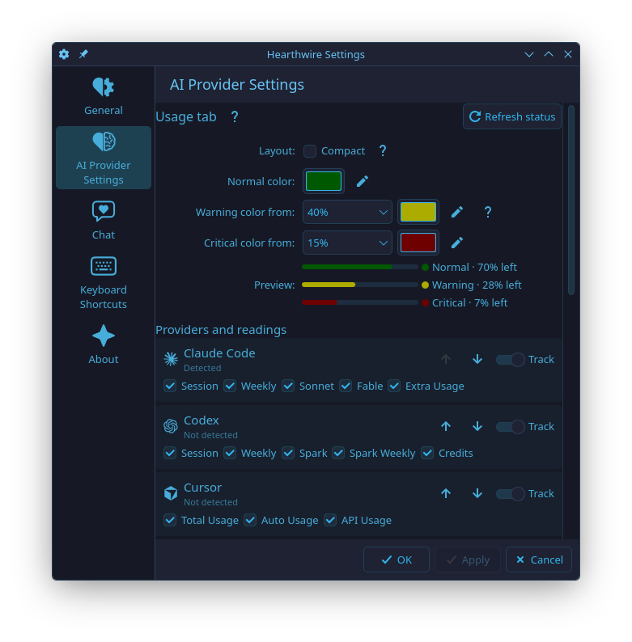
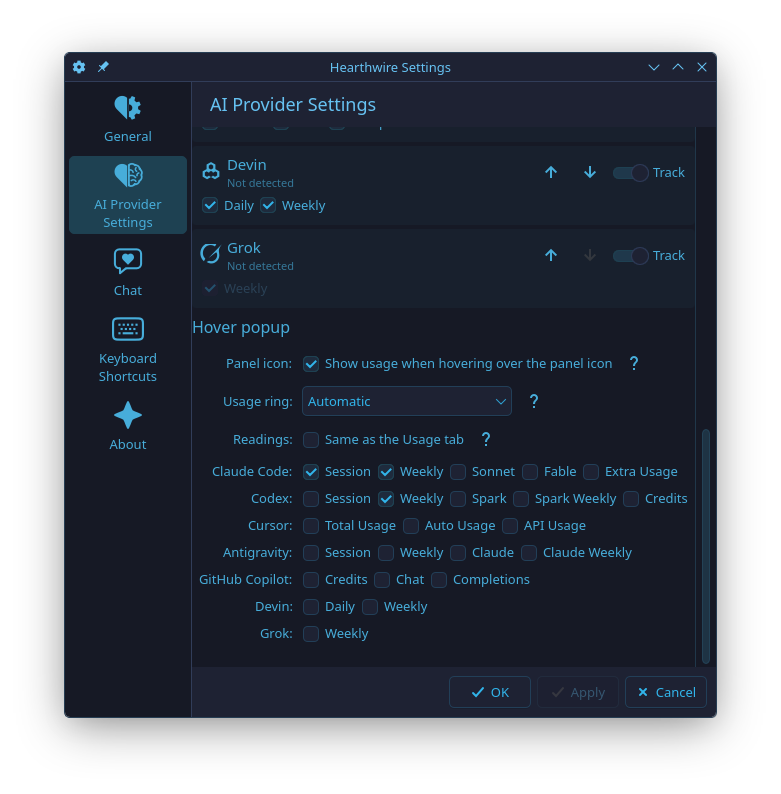

<div align="center">


# Hearthwire — your AI companion

**Chat with AI, privately, right from your KDE Plasma panel — and keep an eye on your AI subscriptions.**

[](https://github.com/flybytech-prog/hearthwire-ai-companion/actions/workflows/tests.yml)
[](https://kde.org/plasma-desktop/)
[](https://www.python.org/)

[](LICENSE)

</div>

Hearthwire sits in your Plasma panel as a small heart-shaped fireplace. Click
it and a popup opens with two tabs:

- **Chat** — use Claude, ChatGPT, Grok, Gemini, GitHub Copilot, Microsoft
  Copilot, a local web UI, or a built-in chat with your own **Ollama** models,
  without opening a browser. Private by default: nothing is saved to disk.
- **Usage** — how much of each AI coding plan you have left (Claude Code,
  Codex, Cursor, Antigravity, GitHub Copilot, Devin, Grok), with reset times.

Security comes first: sign-ins live in memory unless you choose an
**encrypted, passphrase-protected** folder, and the Ollama chat never leaves
plasmashell's memory.

## Screenshots

<table>
<tr>
<td align="center"><br><sub>Chat sites in the popup</sub></td>
<td align="center"><br><sub>Built-in Ollama chat</sub></td>
</tr>
<tr>
<td align="center" colspan="2"><br><sub>Split view: two chat sites side by side</sub></td>
</tr>
<tr>
<td align="center"><br><sub>Encrypted sign-ins, locked</sub></td>
<td align="center"><br><sub>Usage meters</sub></td>
</tr>
<tr>
<td align="center"><br><sub>Settings → General</sub></td>
<td align="center"><br><sub>Settings → Chat</sub></td>
</tr>
<tr>
<td align="center"><br><sub>Settings → AI Provider Settings</sub></td>
<td align="center"><br><sub>Settings → AI Provider Settings → Hover popup</sub></td>
</tr>
</table>

## Features

### Chat

- **Chat sites in the popup**: pick Claude, ChatGPT, Grok, Gemini, GitHub
  Copilot, Microsoft Copilot or Local web UI (Open WebUI) from a dropdown and
  use the site right there. Choose which sites appear under **Settings →
  Chat**.
- **Split view**: the Chat toolbar's **Split** button shows a second site
  next to the first (the same site twice works too), each with its own site
  picker and zoom; you type in each page yourself. Turning Split on widens
  the popup just enough for both sites (if it isn't that wide already), and
  turning it off puts the popup back to the width it had before. Two sites
  use about twice the memory of one; turning Split off closes the second
  page.
- **Private by default**: pages run in an in-memory browser profile. You sign
  in on each site normally; nothing is saved to disk, and you are signed out
  when Plasma restarts or you choose **Clear chat data**. Every site
  permission (microphone, camera, screen sharing, notifications, location,
  clipboard reading) is denied, downloads ask first, and outside links open
  in your browser only after you confirm.
- **Built-in Ollama chat** (optional, off by default): talk to the models of
  the Ollama server on this computer with a native chat — model picker,
  streaming replies with simple formatting, Stop, Copy, Regenerate, Edit and
  Clear, a personality per model, side-by-side compare of two models, and
  text you drag in from other programs. No browser engine, conversation in
  memory only.
- **Stay signed in** (optional, off by default): keep chat sign-ins across
  Plasma restarts in an encrypted folder protected by a passphrase you choose
  (made with gocryptfs). Unlock it once per Plasma session from the Chat tab,
  or use a private session instead. **Lock** it any time from the toolbar, or
  let **Lock automatically** do it after 1 minute to 24 hours of not using
  Chat. If you forget the passphrase, the saved sign-ins are lost; there is no
  recovery. A new sign-in is saved within about 30 seconds, and at once when
  you lock: lock or wait half a minute after signing in before restarting
  Plasma or logging out.
  - **Unlock with KDE Wallet** (Settings → General → Privacy): the folder
    opens with a key kept in your KDE Wallet, silently at Plasma start when
    the wallet is already open, else with one click. The passphrase always
    still works ("Use passphrase instead…"). Anyone who can use your open
    wallet can open the folder too.
- **Prompt library**: the Chat toolbar's **Prompts** button keeps prompts and
  personalities you reuse. With Stay signed in → Encrypted they are saved
  inside the encrypted folder (typed into a KDE text window); otherwise they
  last for this session only. With Ollama a prompt goes into the message box
  and a saved personality can be a model's default; on a web site a click
  copies the prompt to the clipboard.
- **Google sign-in** works on Google's sign-in page (Hearthwire presents
  itself as Firefox there only, because Google refuses embedded browsers).
- **Sign-in pop-ups** open only after a click: a sign-in window a page tries
  to open by itself is dropped, so if nothing appears, click the site's
  sign-in button.
- **Keep open / Minimize**: the popup closes when you click elsewhere unless
  you turn on **Keep the popup open when clicking elsewhere**; the **Minimize**
  button hides it with chat pages, sign-ins and the Ollama conversation
  intact.
- **Zoom per site**: **Ctrl+=** (or **Ctrl++**) or **Ctrl+scroll up** zooms
  in, **Ctrl+-** or **Ctrl+scroll down** zooms out, and **Ctrl+0** goes back
  to 100%, one step at a time from 50% to 200%. Each chat site keeps its own
  zoom, also in its sign-in windows and across Plasma restarts; in the Ollama
  chat the same keys and Ctrl+scroll over the conversation or the message
  box change the text size.

### Usage

- Shows each available quota, plan, reset time, extra usage or credits, with
  **Left** and **Used** display modes. You choose which readings each
  provider shows (all of them by default) and the order of the providers.
- **Updated N min ago** at the top of the tab, with a **Refresh** button.
  The button is there also while the first reading loads or after it failed,
  and is grayed out while a refresh is running.
- **Next reset**: a line under it names the soonest reset among the readings
  the tab shows, such as "Next reset: Claude Code Session in 2h 10m".
- **Accent strips**: a thin strip in a color of its own runs along the
  leading edge of each provider's section, so providers are easy to tell
  apart. It is decoration only, with a light and a dark variant that follow
  your theme.
- **Compact layout** (optional): one slim bar per reading with its name,
  value and a short time until reset (such as Weekly, 38%, 2d 4h), without
  plan names or captions; errors still show, on one line.
- **Colors**: bars use a teal color, then turn to your theme's warning
  color from 60% used (40% left) and to its critical color from 85% used
  (15% left). Both levels can be changed in steps of 5%, and each of the
  three colors can be set with a color box (a reset button goes back to
  the default). A preview next to the color boxes shows a sample bar and dot
  for each level in the colors you picked, before you apply them.
- **Hover popup**: hover over the panel icon for a short summary: each
  provider's name in bold, then one reading per line, such as **Session**
  62% left and **Weekly** 80% left, each with a dot in its level color
  (money and credits get no dot). It shows the Usage tab's readings, or
  readings you choose per provider. Claude Code has no daily limit: its
  **Session** is the 5-hour window and **Weekly** the 7-day one.
- **Usage ring** (on by default): a ring around the panel icon shows one
  reading in the level colors. **Automatic** uses the first reading of the
  first provider in the hover popup that has data; you can pick another
  reading or turn the ring off. With Left the ring drains as usage grows,
  with Used it fills. It is dimmed while it shows an old reading, and hidden
  while the reading has no percentage (for example credits) or the Usage tab
  is hidden.
- **Usage history** (optional, off by default): when you turn it on, the
  widget keeps 7 days of each reading's percent used on this computer and
  draws a small graph under each bar in the standard layout (not in Compact).
  Hours without a reading leave a gap. Each widget keeps its own history;
  turning it off deletes that widget's. See
  [docs/privacy.md](docs/privacy.md#usage-history).
- Detects installed tools through the Plasma login environment, CLI names, and
  Linux/XDG data locations, and contacts only providers that are both
  installed and tracked.
- Keeps successful readings in Plasma session memory when a temporary or
  rate-limit error occurs. Usage is written to disk only if you turn on
  **Usage history**.
- **Notifications** (optional, off by default): a notification when a plan
  drops to a level of usage left you choose (5% to 50%), and when such a plan
  resets.
- Refreshes rotating OAuth credentials back to their exact source with
  compare-before-write protection, and uses Linux Secret Service through
  `secret-tool` without placing secrets in process arguments.

### Settings

Plasma's standard configuration dialog with three pages of its own —
**General** (popup, usage display, refresh and notifications, privacy,
backup),
**AI Provider Settings** (providers and their order, the Usage tab's
readings, layout and colors, and the hover popup) and **Chat** (sites and
addresses) — plus Plasma's **Keyboard Shortcuts** and **About**. Longer explanations sit behind the small **?** buttons. Hearthwire
starts with Plasma while it remains on a panel.

### Chat sites

- **GitHub Copilot** opens GitHub's sign-in page and goes on to
  `github.com/copilot` once you are signed in (signed-out visitors to
  `/copilot` only get a landing page). Google and Apple sign-in may be
  refused inside the widget; GitHub's own sign-in and two-factor prompts work.
- **Ollama** talks straight to the [Ollama](https://ollama.com) server on this
  computer and shows its own simple chat: pick a model, type, and the reply
  streams in. Turn it on under **Settings → Chat**, then choose it in the
  Chat tab's dropdown. It lists the models you have installed (install one in
  a terminal with `ollama pull llama3`; **Reload models** picks up new ones);
  cloud models are hidden because they send your messages to ollama.com.
  Enter sends, Shift+Enter adds a line, Esc or **Stop** ends a reply, each
  reply and code block has a Copy button, and **Clear conversation** drops it
  from memory and asks Ollama to unload the models it used. Your messages
  sit on the right in a bubble of your theme's highlight color, replies on
  the left in a faint one. **Regenerate**
  (on the last reply) asks again, **Edit** (on your last message) puts it back
  into the message box. Replies show headings, lists, bold, italic and inline
  code, with fenced code blocks in a monospace font, all as plain text; links,
  images, HTML and tables are shown as they are and never load or open
  anything.
  - **Personality**: the toolbar's Personality button sets an instruction for
    the current model ("Answer briefly, in German."), sent first with every
    message to it. It is kept in memory only, until you turn Ollama off or
    Plasma restarts; Clear keeps it.
  - **Compare two models**: the toolbar's Compare button adds a second model
    and pane. Each message goes to the first model, then to the second, and
    each pane keeps its own conversation; Stop also cancels the second
    model's turn. Both models stay loaded until Clear, so this needs memory
    for both. The panes sit side by side when the popup is wide enough
    (**Settings → General → Size: Large**), else one above the other.
  - **Drag and drop**: drag text, or one text file (up to 128 KB), from
    another program onto the chat or onto the panel icon, and it lands in the
    message box (nothing is sent until you press Send). Hearthwire never starts Ollama: if
  it isn't running, the Chat tab says so and shows
  `systemctl start ollama` (or `ollama serve`). The address is
  `http://127.0.0.1:11434` unless you change it under **Show advanced
  settings → Ollama address**; only `http://` on this computer (`127.0.0.1`,
  `localhost`, `[::1]`) with a port is accepted. Before it sends anything,
  Hearthwire checks that the program on that port belongs to you or to the
  system (the packaged `ollama` service), never to another user.
- **Local web UI (Open WebUI)** shows a chat web interface running on this
  computer, by default `http://localhost:3000/`, for example
  [Open WebUI](https://github.com/open-webui/open-webui) on top of Ollama:
  `docker run -d -p 3000:8080 --add-host=host.docker.internal:host-gateway -v open-webui:/app/backend/data --name open-webui ghcr.io/open-webui/open-webui:main`
  (or `open-webui serve`, which listens on port 8080; set that address below).
  As for Ollama, the page loads only when the program on that port belongs
  to you or to the system, never to another user.
- **Custom addresses**: under **Settings → Chat → Show advanced settings**
  each site can open a different address, for example a self-hosted
  instance. Leave a field empty to use the built-in address. Addresses must
  use `https://`; only Local web UI may also use plain `http://`, and only for this
  computer (`localhost`, `127.0.0.1`, `[::1]`). A custom address adds only its
  exact host to the site, never its subdomains. Don't put passwords or tokens
  in an address; it is stored in your Plasma configuration file. The widget
  never opens a page, window or embedded frame on this computer for any site
  but Local web UI, and for it allows plain `http://` only at the configured
  address; background requests a page makes itself (fetch, WebSocket, images)
  aren't filtered, as in any browser. "This computer" means `localhost`,
  `*.localhost`, `localhost.localdomain`, `*.localhost.localdomain`,
  `ip6-localhost`, `ip6-loopback`, every name without a dot, `[::1]`,
  `0.0.0.0` and any `127.x.x.x` address. So a Local web UI on another machine
  must be addressed by a full name (e.g. `nas.lan`): a short name like `nas`
  is treated as this computer and owner-checked. See
  [docs/privacy.md](docs/privacy.md).
- **A chat server on another machine** (for example Open WebUI on your home
  server): give it an `https://` address with a certificate your system
  trusts (self-signed certificates are refused), or forward it to this
  computer with an SSH tunnel such as `ssh -N -L 3000:localhost:3000 server`
  (use `ssh -N -L 3000:server:3000 gateway` when it runs on a third machine)
  and keep Local web UI at `http://localhost:3000/`. Without a tunnel, give
  it a full name such as `nas.lan`: a short name counts as this computer.

### Settings → General

- **Popup**: **Open on** Chat or Usage; **Show tabs** Usage and Chat (at
  least one stays on); **Size** Compact, Normal or Large (never larger than
  the screen; changing it resizes the popup, which otherwise keeps the size
  you last left it at); **Keep the popup open when clicking elsewhere**. A hidden Chat
  tab starts no chat page, web engine or Ollama chat, and hiding it locks
  open saved sign-ins. A hidden Usage tab runs no usage refresh, and the panel
  icon's tooltip shows only the name. The keyboard shortcut itself is set in
  Plasma's own **Keyboard Shortcuts** page; **Keyboard shortcut opens**
  chooses what it opens: the popup as when clicking the icon, Chat, the
  Ollama message box (ready to type; the normal popup while Ollama is off) or
  Usage. Pressing the shortcut again closes the popup. **Middle-click
  opens** is a mouse action, not a shortcut: a middle-click on the panel icon
  refreshes usage (the default), or opens the Usage tab, the Ollama message
  box or a chat site. If the popup already shows that tab or site, it
  closes; while that tab is hidden or that site is off, a middle-click acts
  as a normal click.
- **Usage**: **Display** Left or Used (for the Usage tab and the hover
  popup), **Refresh every**, and **Notifications**: **Notify when
  a plan drops below** a percentage **left** (20% by default, whatever
  Display shows) and **Notify when a plan resets** (only for a plan that had
  dropped that low). Plans are checked at each usage refresh while the Usage
  tab is shown; a plan already that low when Plasma starts doesn't notify.
  Mute or adjust them under **System Settings → Notifications →
  Hearthwire**.
- **Privacy**: **Usage history** (off by default; keeps 7 days of usage for
  the Usage tab's graphs) with a **Delete usage history** button, **Stay
  signed in** (Off or Encrypted), **Lock automatically**, and under **Show
  folder actions** **Change passphrase…** and **Delete encrypted folder…**.
  Turning Usage history off and applying deletes this widget's stored
  history; if that fails, the Usage tab says so and the widget tries again
  later.
- **Backup**: **Export** saves your settings to one fixed file,
  `~/.config/hearthwire/settings-backup.json` (only you can read it), and
  asks first before it replaces an earlier backup. **Import** reads that
  file back and, after you choose **Replace**, fills in the settings;
  nothing is saved until you press **Apply** on the General page; the
  confirmation first lists any chat address the import would change. Export
  saves the applied settings only, so press **Apply** first: the helper reads
  them from Plasma's own settings file, and no setting is passed on a command
  line. The backup holds the usage, popup and
  chat site settings, including custom chat addresses. It never holds
  sign-ins or anything about the encrypted folder (Stay signed in, Lock
  automatically, Unlock with), the zoom of each site, or the Usage history
  choice. See [docs/privacy.md](docs/privacy.md#settings-backup).

The hover popup's settings are under **Settings → AI Provider Settings**
(see below).

### Settings → AI Provider Settings

- **Usage tab**: **Layout: Compact** (one slim bar per reading); **Normal
  color**; **Warning color from** (60% used by default) and **Critical
  color from** (85% used by default), each with its color box. The levels
  read as left or used, as **General → Display** shows (with Left the
  defaults read 40% and 15%); when one pick passes the other level, that
  other level moves so the critical one stays further along. The reset button
  next to a color box goes back to the default color; a Critical box left
  empty uses your Warning color, if you chose one. **Preview** shows a
  sample bar and dot for Normal, Warning and Critical in the chosen colors,
  before you apply them. The **Refresh
  status** button checks the tracked providers once.
- **Providers and readings**: one row per provider, in the order the Usage
  tab, the hover popup and the notifications list them. The **Move up** and
  **Move down** arrow buttons move a tracked provider past the next tracked
  one (untracked providers keep their place and can't be moved); **Track** turns it on or off; the reading boxes
  (for example Claude Code's Session, Weekly, Sonnet, Fable and Extra Usage)
  choose what the Usage tab shows. Every box is ticked at first, which also
  shows readings added later; the last ticked box can't be unticked (turn
  **Track** off instead). A reading the provider doesn't report right now is
  marked "(unavailable)".
- **Hover popup**: **Show usage when hovering over the panel icon** and
  **Readings**: **Same as the Usage tab** (the ticked
  readings, or each provider's main reading, such as Weekly, while all of its
  readings are ticked), or untick it to choose each tracked provider's own
  readings, for example Claude Code's Session, its 5-hour window, next to
  Weekly. Percentages say "left" or "used" as **General → Display** shows.
- **Usage ring** (in the Hover popup section, next to the panel icon
  choice): **Automatic** (the default), **Off**, or one reading such as
  "Claude Code: Weekly". Automatic follows the hover popup's first provider
  with data and its first reading. Extra usage can't be chosen, since money
  has no limit to draw. The choice is grayed out while the Usage tab is
  hidden.

Usage notifications follow the Usage tab's ticked readings, or each
provider's main reading while all of its readings are ticked.

Upgrading from a version where these boxes chose only the hover popup's
readings: on its first start the widget moves that choice to the hover
popup's own **Readings** (unless it already had its own), so the hover popup
shows the same as before, and the Usage tab starts with every reading shown.

Fresh installs open on Chat, show both tabs at Normal size, track all
providers in catalog order with every reading shown in the standard layout,
display usage left, refresh every five minutes, color bars from 60% and 85%
used, show the Automatic usage ring, refresh usage on a middle-click, keep no
usage history, and send no notifications.

## Configure usage providers

Under **Settings → AI Provider Settings**, track only the tools you use, put
them in the order you want, and untick the readings you don't need in the
Usage tab. The hover popup shows the same readings unless you untick
**Same as the Usage tab** there and choose its own.

## Install

```bash
git clone --branch main https://github.com/flybytech-prog/hearthwire-ai-companion.git
cd hearthwire-ai-companion
./scripts/install.sh --restart-plasma
```

The script first checks what Hearthwire needs. When you run it in a terminal
on Arch, it offers (y/N) to install anything missing with `sudo pacman`:
required Qt/KDE modules, Qt WebEngine for the Chat tab, and gocryptfs,
kdialog and fuse3 for Stay signed in; otherwise it prints the command to run.
Ollama is only described, since you choose the build for your graphics card.
It then removes the old AI Usage widget, helper, and cache if they are
present, installs the dependency-free Python helper into the user Python site,
installs or upgrades the plasmoid, the color app icon and the settings and
tab icons, and optionally
reloads Plasma.

Then right-click the panel, choose **Add Widgets…**, search for **Hearthwire**,
and add it. The first launch opens Settings once. A widget carried over from
the previous name stays on the panel and isn't added again; see the upgrade
section below.

Manual installation remains available:

```bash
python3 -m pip install --user --break-system-packages .
kpackagetool6 -t Plasma/Applet -i plasmoid
mkdir -p ~/.local/share/icons/hicolor/scalable/apps
rm -f ~/.local/share/icons/hicolor/scalable/apps/hearthwire{,-settings-general,-settings-ai,-settings-chat}.svg
cp assets/hearthwire.svg assets/hearthwire-settings-{general,ai,chat}.svg ~/.local/share/icons/hicolor/scalable/apps/
```

Use `-u plasmoid` instead of `-i` when the package is already installed.
The app icon and the settings and tab icons are loaded from
`~/.local/share/icons/hicolor/scalable/apps/`, so copy them there too.

To delete saved chat sign-ins when you stop using Hearthwire, first lock the
encrypted folder in the Chat tab (or turn Stay signed in off), then run:

```bash
./scripts/install.sh --uninstall-web-data
```

It deletes the encrypted folder (with its KDE Wallet key, if you set that
up), the usage history of every widget if there is any, the usage alert events file
(`knotifications6/hearthwire.notifyrc`) and the icons
(`icons/hicolor/scalable/apps/hearthwire*.svg`, the four listed above) and
nothing else, and refuses while the folder is unlocked. A settings backup
file (`~/.config/hearthwire/settings-backup.json`) stays in place, and the
script says so.

To remove a manual installation:

```bash
kpackagetool6 -t Plasma/Applet -r io.github.flybytechprog.hearthwire
python3 -m pip uninstall --break-system-packages hearthwire
rm -f ~/.local/share/icons/hicolor/scalable/apps/hearthwire{,-settings-general,-settings-ai,-settings-chat}.svg
rm -f ~/.local/share/knotifications6/hearthwire.notifyrc
```

When upgrading from AI Usage 2.x by hand, remove the old helper and widget
first, so the two never refresh the same sign-ins at once:

```bash
python3 -m pip uninstall --break-system-packages ai-usage-kde
kpackagetool6 -t Plasma/Applet -r com.bgn.aiusage
```

## Upgrading from AI Usage 2.x

Hearthwire 1.0.0 is the renamed AI Usage 2.x. Run the installer once:

```bash
./scripts/install.sh --restart-plasma
```

It removes the old `com.bgn.aiusage` widget, the old `ai-usage-kde` Python
helper, and the old cache files in `$XDG_CACHE_HOME/ai-usage-kde`. After Plasma
reloads, remove the old widget's placeholder from your panel if it is still
there, then add **Hearthwire** once through **Add Widgets…**. Settings start
fresh because the widget has a new ID. Nothing needs to be re-authenticated:
Hearthwire reads the same provider sign-ins as before.

## Upgrading from Hearthside

Hearthwire is the new name of Hearthside. Your data moves over once, when
`scripts/install.sh` runs. Only the installer does this: after a manual `pip`
or `kpackagetool6` install nothing has moved, and the encrypted folder can't
be created or opened until the installer has run (the Chat tab says so).

What moves:

- **The encrypted folder**: `~/.local/share/hearthside` becomes
  `~/.local/share/hearthwire`, with your saved sign-ins and prompt library.
  It is renamed in place, never copied.
- **The KDE Wallet entry**, if you use Unlock with KDE Wallet: the key moves
  from the wallet folder `Hearthside` to `Hearthwire`. The old entry is removed
  only after the new one has really opened the encrypted folder.
- **Your notification choices**: `~/.config/hearthside.notifyrc` becomes
  `~/.config/hearthwire.notifyrc`.
- **The panel widget and its settings**: it keeps its place, its settings,
  its keyboard shortcut and its saved sign-ins.

The old helper, widget package, icons and notification events file are removed.
The Antigravity token cache is deleted rather than moved; it is rebuilt when
needed.

To upgrade:

1. Lock the encrypted folder in the Chat tab. While it is unlocked the
   installer stops before changing anything.
2. Update your checkout to the latest `main` and run:

   ```bash
   ./scripts/install.sh --restart-plasma
   ```

   Plasma stops for a moment and starts again.
3. If you use Unlock with KDE Wallet, KDE Wallet asks once whether to allow
   Hearthwire. Allow it. If the wallet is locked or you refuse, the passphrase
   still works, and running the installer again finishes moving the key.

The widget does **not** need re-adding.

Before it changes Plasma's widget configuration, the installer saves a copy
as `~/.config/plasma-org.kde.plasma.desktop-appletsrc.hearthside-backup`. The
next complete install deletes that copy automatically.

The wallet folder `Hearthside` stays behind empty. You may delete it by hand
in KWalletManager.

To go back, lock the encrypted folder and run:

```bash
./scripts/install.sh --rollback-hearthwire
```

That moves everything back to the old names and uninstalls Hearthwire (add
`--restart-plasma` if you don't want to be asked before Plasma stops). Then
check out the `hearthside-final` tag and run its `scripts/install.sh`.

## Helper CLI

```bash
hearthwire --json
hearthwire --providers=claude,codex
hearthwire --catalog
hearthwire --detect
```

The JSON v2 response includes the provider catalog, detected provider IDs,
status/failure classification, available metrics, quota windows, billing
usage, reset/retry times, and no credential data.

The widget also runs the helper for the usage history (`--usage-history`)
and the settings backup (`--settings-backup`); see
[Provider contracts](docs/provider-contracts.md#usage-history-helper).

## Requirements

- KDE Plasma 6 and Qt 6, with the Qt Quick Shapes QML module for the usage
  ring (Arch: `qt6-declarative`; Fedora: usually `qt6-qtdeclarative`;
  Debian/Ubuntu: `qml6-module-qtquick-shapes`; package names may vary)
- Python 3.11 or newer; standard library only
- `secret-tool` when a provider stores its session in Linux Secret Service
- For the Chat tab only: Qt WebEngine 6.8 or newer with its QML module
  (Arch: `qt6-webengine`; Fedora: `qt6-qtwebengine`; Debian/Ubuntu:
  `qml6-module-qtwebengine`; package names may vary). It also needs the Qt
  Quick Dialogs QML module, usually already installed with Plasma (Arch:
  `qt6-declarative`; Debian/Ubuntu: `qml6-module-qtquick-dialogs`). Without
  these the usage view works as before and the Chat tab explains what to
  install. Each open
  chat site uses roughly 200–500 MB of memory until Plasma restarts or you
  clear chat data.
- For the Ollama chat only: [Ollama](https://ollama.com) installed and
  running on this computer, with at least one model pulled. Qt WebEngine is
  not needed for it.
- For Stay signed in only: gocryptfs 2 (`sudo pacman -S --needed gocryptfs`
  on Arch), plus kdialog and fuse3, which are usually already installed with
  KDE. The Chat tab shows the install command if something is missing.

## Privacy

A usage refresh prints or caches no tokens, credential fingerprints, raw API
responses or local transcripts. Usage history is kept only if you turn it on:
then the percent used of each reading, one value per hour for 7 days, in
`~/.local/share/hearthwire/usage-history/`, one file per widget (only you
can read it). A settings
backup exists only if you export one; it names the chat sites and custom
addresses you use, but never holds sign-ins. Antigravity's derived access-token cache
is the only authentication cache created by Hearthwire; it is stored with mode
`0600` under `$XDG_CACHE_HOME/hearthwire` and keyed to a one-way refresh-token
fingerprint.

The Chat tab keeps cookies, sessions, and site data in memory only, denies
every site permission (microphone, camera, screen sharing, notifications,
location, clipboard reading), asks before each download, asks before opening
an outside link in your browser (which may keep it in its history), and
never reads or scripts the pages. When a page moves to a site outside the one you chose, a
notice above it names the real host. Provider names, plans and errors, Ollama
replies and download names are shown as plain text, with hidden and control
characters made visible. The Chat tab's engine is Qt WebEngine (Chromium):
keep it updated and restart Plasma after it updates. Page console messages
are discarded. Custom chat addresses are stored in plain text in your Plasma
configuration file. With Stay signed in, sign-ins and site data are saved
only in your encrypted folder; while it is unlocked, programs running as you
can read it. The Ollama chat keeps the conversation in memory only and sends
it over loopback to the Ollama server on this computer, which can read it
(see [Ollama](docs/privacy.md#ollama-built-in-chat)). The
[Chat tab privacy notes](docs/privacy.md#chat-tab) also list what it does not
protect against.

See [Privacy](docs/privacy.md) and
[Provider contracts](docs/provider-contracts.md).

## Development

```bash
python -m venv .venv
source .venv/bin/activate
python -m pip install -e ".[test]"
QT_QPA_PLATFORM=offscreen python -m pytest
python3 -m compileall -q src
/usr/lib/qt6/bin/qmllint plasmoid/contents/ui/*.qml
QT_QPA_PLATFORM=offscreen /usr/lib/qt6/bin/qmltestrunner -input tests/qml
```

## Credits

Hearthwire began as a fork of
[AI Usage for KDE](https://github.com/burakgon/ai-usage-kde-widget) by Burak
([@burakgon](https://github.com/burakgon)), whose usage-meter widget and helper
are the foundation of the Usage tab. Thank you! The original MIT copyright
notice is kept in [LICENSE](LICENSE).

## License

[MIT](LICENSE)
